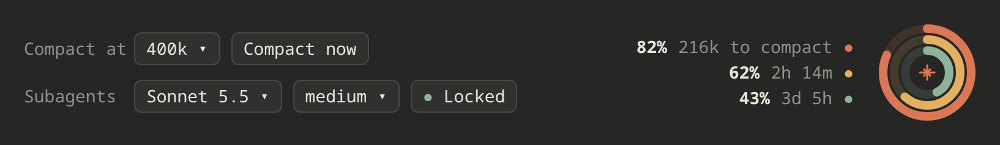

# Context Controls for Claude Code

A small panel that sits above the Claude Code prompt. It shows how much room you have left, and lets you choose when Claude compacts and which model your subagents use.



## What you see

**The rings** (right side). Hover a ring to see its number.

| Ring | Colour | Shows |
| --- | --- | --- |
| Outer | orange | How much of the context window is still free |
| Middle | gold | How much of your 5-hour limit is left, and when it resets |
| Inner | green | How much of your weekly limit is left, and when it resets |

The numbers update every 10 seconds.

**Compact at.** Pick how full the context can get before Claude compacts it on its own (100k to 750k tokens). **Compact now** compacts right away.

**Subagents.** Pick a model and an effort level. Press **Locked** to make every subagent use them. Press it again to unlock, and subagents choose for themselves.

## Install

You need Claude Code 2.1.287 or newer. Type these in Claude Code:

```text
/plugin marketplace add DerpcatMusic/claude-context-controls
/plugin install context-controls@context-controls
/reload-plugins
```

## Good to know

- **The panel wins over `settings.json`.** If your `settings.json` sets compaction or subagent model values in `env`, the panel replaces them with your panel choices. You don't need to delete anything.
- Your choices are saved and come back in every new session.
- You can also type commands instead of clicking:
  `/control-panel percent 40`, `/control-panel compact now`, `/control-panel model claude-opus-5-5`, `/control-panel effort high`, `/control-panel lock on`

## For developers

```bash
claude plugin validate .
claude plugin test .
```

All the code is in [`hooks/register.js`](hooks/register.js).

MIT licensed.
